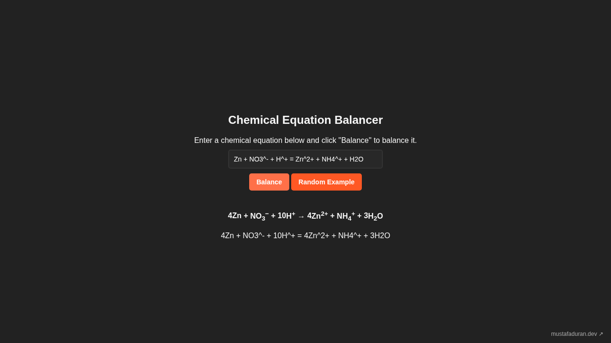

# Stoichiometry Calculator - Chemical Reaction Balancer

A small web page that balances chemical equations. You type an unbalanced
reaction such as `Fe + O2 = Fe2O3`, press **Balance** (or Enter), and it shows
the equation with the smallest whole-number coefficients:
4Fe + 3O<sub>2</sub> → 2Fe<sub>2</sub>O<sub>3</sub>.

It runs entirely in the browser with plain HTML, CSS and JavaScript. There is
no build step and no dependencies.



## Features

- `=`, `->` or `→` between the two sides, `+` between terms:
  `C3H8 + O2 = CO2 + H2O`. Coefficients you type yourself are ignored.
- Groups in round or square brackets, nested: `Ca(OH)2`, `K4[Fe(CN)6]`.
- Hydrates with a middle dot: `CuSO4·5H2O` (`*` also works).
- Ions: write the charge after `^`, e.g. `SO4^2-`, `H^+`, `Fe^3+`. A free
  electron is `e`. Charge is balanced like an extra element.
- Element symbols are checked against the periodic table.
- Output with real subscripts and superscripts, plus a plain-text line you can
  copy.
- **Random Example** fills in and balances one of 20 built-in reactions
  (combustion, redox, ionic equations).
- Clear errors: unknown element, missing bracket or `=`, an element that
  appears on only one side, equations with no solution or with more than one
  independent solution. Syntax errors highlight where the problem is.

## How the balancing works

Everything is in `main-js/balancer.js`:

1. **Parsing.** A small hand-written parser reads each term into a map of
   element → atom count, plus its charge. Brackets multiply everything inside
   them; a hydrate part is multiplied by its leading number.
2. **Matrix.** One row per element (and one for charge if any term is
   charged), one column per term. Left-side terms are positive, right-side
   terms negative, so a balanced equation is a vector `x` with `A·x = 0`.
3. **Solving.** The matrix is reduced to row echelon form with exact
   fractions built on `BigInt`, so there is no floating-point rounding and no
   overflow on large equations. If there is exactly one free column, it is set
   to 1 and the other coefficients follow from it.
4. **Whole numbers.** The fractions are multiplied by the least common
   multiple of their denominators and divided by their greatest common divisor,
   which gives the smallest whole-number coefficients. If any of them would be
   zero or negative, the equation is reported as not balanceable as written.

## How to run

```sh
git clone https://github.com/mustafa-duran-01/stoichiometry-calculator.git
cd stoichiometry-calculator
xdg-open index.html   # or just double-click the file
```

Or serve it locally:

```sh
python3 -m http.server 8000
# then open http://localhost:8000
```

## Project structure

```
.
├── index.html          Page markup (input, buttons, output)
├── main-js/
│   └── balancer.js     Parser, matrix solver and page handlers
├── style/
│   └── style.css       Dark theme and layout
└── docs/
    └── screenshot.png
```

## Background

The page itself (layout and styling) was built in June 2023 as a high-school
project and is published on
[mustafaduran.dev](https://mustafaduran.dev/projects/project2/).

The first version relied on a third-party balancing script whose license does
not allow redistribution, so it is not part of this repository. In October
2026 the balancer was rewritten from scratch (`main-js/balancer.js`) with the
help of an AI assistant.

## License

MIT © 2023, 2026 Mustafa Duran. See [LICENSE](LICENSE).
